# B2 SISR - Mathis PAHU

## TP - Introduction à Docker

**Environnement :** VM Debian 12, Docker 29.10.0

---

## Présentation de Docker :

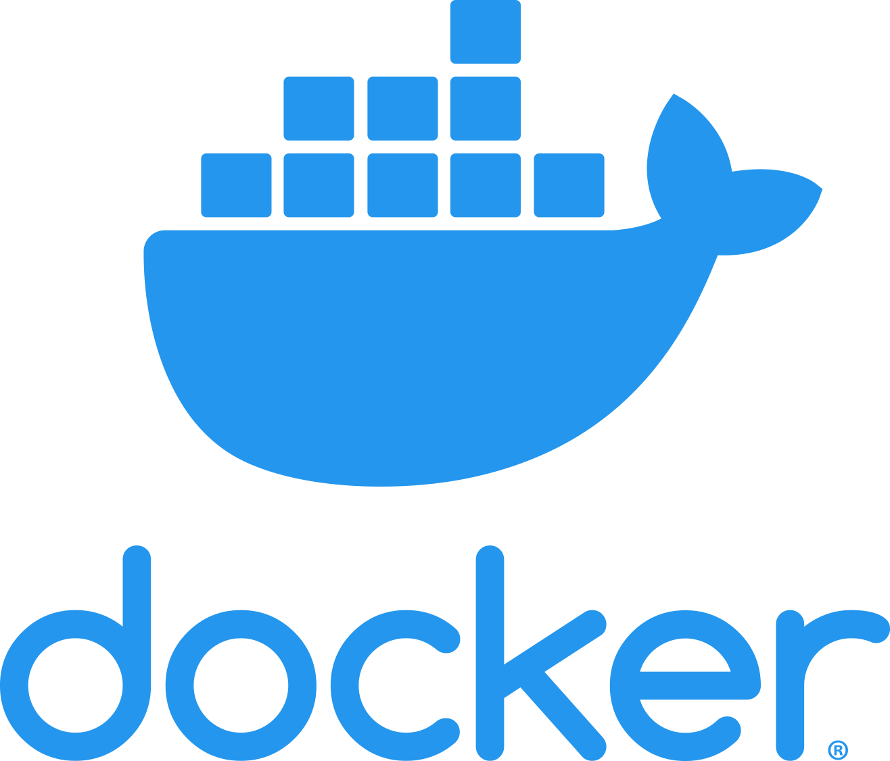

<aside>
🐋

**Docker** est une plateforme qui permet de créer, distribuer et exécuter des applications dans des **conteneurs** : des environnements isolés et légers qui embarquent l’application et tout ce dont elle a besoin (bibliothèques, configuration). Une application fonctionne ainsi de la même façon sur n’importe quelle machine, sans le poids d’une machine virtuelle complète.

</aside>

## 1. Installation

Pour commencer, nous installons Docker sur la VM Debian à partir du dépôt officiel Docker : [https://docs.docker.com/get-docker/](https://docs.docker.com/get-docker/)

Nous mettons d’abord le système à jour et installons les outils nécessaires, puis nous ajoutons la clé et le dépôt de Docker avant d’installer les paquets.

```bash
sudo apt-get update
sudo apt-get install -y ca-certificates curl
sudo install -m 0755 -d /etc/apt/keyrings
sudo curl -fsSL https://download.docker.com/linux/debian/gpg -o /etc/apt/keyrings/docker.asc
sudo chmod a+r /etc/apt/keyrings/docker.asc
echo "deb [arch=$(dpkg --print-architecture) signed-by=/etc/apt/keyrings/docker.asc] https://download.docker.com/linux/debian$(. /etc/os-release && echo $VERSION_CODENAME) stable" | sudo tee /etc/apt/sources.list.d/docker.list > /dev/null
sudo apt-get update
sudo apt-get install -y docker-ce docker-ce-cli containerd.io docker-buildx-plugin docker-compose-plugin
```

### Fonction des commandes

| Commande | Fonction |
| --- | --- |
| `sudo apt-get update` | Met à jour la liste des paquets |
| `sudo apt-get install -y ca-certificates curl` | Installe curl et les certificats HTTPS |
| `sudo install -m 0755 -d /etc/apt/keyrings` | Crée le dossier des clés de confiance des dépôts, avec les droits `755` |
| `sudo curl -fsSL https://download.docker.com/linux/debian/gpg -o /etc/apt/keyrings/docker.asc` | Télécharge la clé GPG de Docker. `-o` indique le fichier de destination |
| `sudo chmod a+r /etc/apt/keyrings/docker.asc` | Rend la clé lisible par `apt` |
| `echo "deb [...] ..." | sudo tee /etc/apt/sources.list.d/docker.list > /dev/null` | Ajoute le dépôt Docker à la liste des sources de `apt` |
| `sudo apt-get update` | Recharge la liste des paquets pour prendre en compte le nouveau dépôt Docker |
| `sudo apt-get install -y docker-ce docker-ce-cli containerd.io docker-buildx-plugin docker-compose-plugin` | Installe Docker et ses composants |

Une fois l’installation terminée, nous vérifions la version de Docker, puis nous lançons le conteneur de test `hello-world` pour confirmer que tout fonctionne.

```bash
docker -v
docker-compose -v
docker run hello-world
```

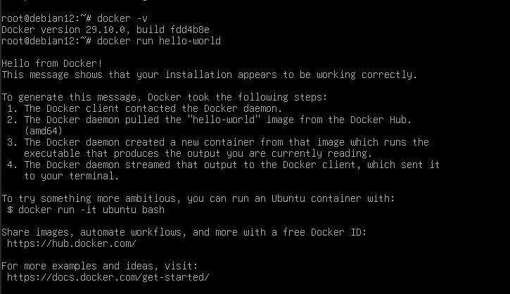

Docker Compose est également installé, comme le montre la version obtenue :

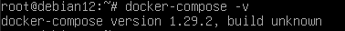

---

## 2. Images et conteneurs

Nous téléchargeons ensuite l’image `nginx` depuis le Docker Hub. Nous lançons le conteneur en mode détaché (`-d`) en redirigeant le port 8080 de la VM vers le port 80 du conteneur (`-p 8080:80`), puis nous testons le serveur avec `curl`.

| Commande | Fonction |
| --- | --- |
| `docker pull nginx` | Télécharge l’image nginx depuis le Docker Hub |
| `docker run -p 8080:80 -d nginx` | Lance un conteneur nginx en arrière-plan (`-d`), avec le port 8080 de la VM redirigé vers le port 80 du conteneur (`-p 8080:80`) |
| `curl localhost:8080` | Teste le serveur : la page « Welcome to nginx! » doit s’afficher |

```bash
docker pull nginx
docker run -p 8080:80 -d nginx
curl localhost:8080
```

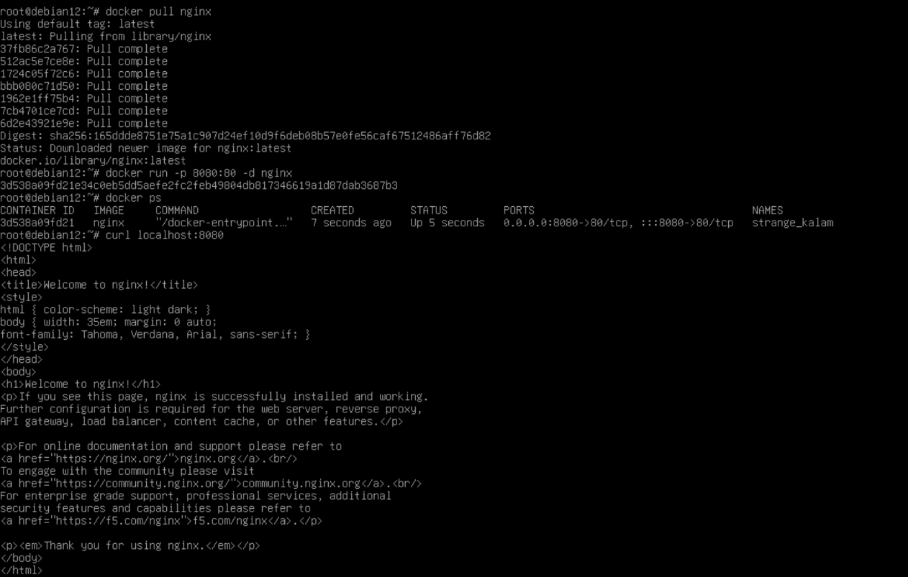

La page « Welcome to nginx! » s’affiche : le serveur web fonctionne dans le conteneur.

### Fonction des commandes

Nous observons ensuite l’état de Docker avec trois commandes de consultation.

| Commande | Fonction |
| --- | --- |
| `docker ps` | Liste les conteneurs **en cours d’exécution** |
| `docker ps -a` | Liste **tous** les conteneurs (en cours et arrêtés) |
| `docker images` | Liste les **images** présentes en localdocker ps, ps -a, images |

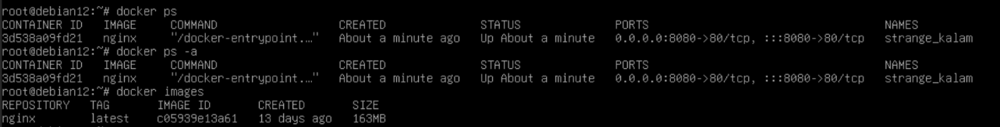

### Gestion des conteneurs et images

Voici les commandes pour arrêter et supprimer un conteneur ou une image, ainsi que pour lancer Apache.

| Fonction | Commande |
| --- | --- |
| Arrêter un conteneur | `docker stop <nom_ou_id>` |
| Supprimer un conteneur | `docker rm <nom_ou_id>` |
| Supprimer une image | `docker rmi <image>` |
| Télécharger l’image Apache | `docker pull httpd` |
| Lancer Apache en détaché (port 8081 → 80) | `docker run -d -p 8081:80 httpd` |

Nous téléchargeons l’image Apache (`httpd`), la lançons sur le port 8081, puis nous vérifions avec `curl` que la page « It works! » s’affiche.Apache : pull, run, curl

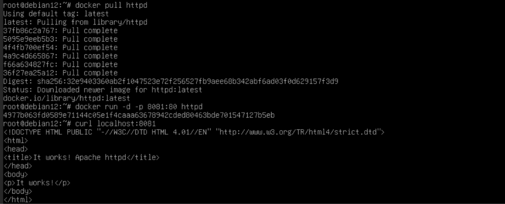

Avant de passer à la suite, nous supprimons tous les conteneurs et images utilisés afin de repartir d’un environnement propre :

```bash
docker rm -f $(docker ps -aq)
docker rmi httpd nginx
```

---

## 3. Création de votre image

### Image Debian

Dans cette partie, nous créons notre propre image. Nous créons d’abord un dossier de travail `lab0`, puis le fichier `Dockerfile` qui décrit la « recette » de l’image.

```bash
mkdir lab0 && cd lab0
nano Dockerfile
```

Ce Dockerfile part d’une image Debian allégée et y installe les outils `vim`, `git`, `htop`, `mc` et `tree`. La dernière ligne nettoie le cache pour alléger l’image.

```docker
FROM debian:stable-slim
MAINTAINER BTS SIO2 SISR
RUN apt-get update \
 && apt-get install -y vim git htop mc tree \
 && apt-get clean \
 && rm -rf /var/lib/apt/lists/* /tmp/* /var/tmp/*
```

Nous construisons l’image avec `docker build` (sans oublier le point final), vérifions sa présence, puis lançons un conteneur et entrons dedans.

```bash
docker build -t btssio:v1.0 .
docker images
docker run -tid --name sisr btssio:v1.0
docker exec -ti sisr bash
```

**Taille de l’image `btssio:v1.0` : 266 Mo** (base `debian:stable-slim` : 78,9 Mo).

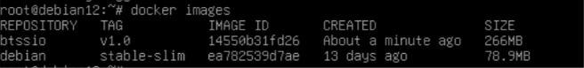

Une fois dans le conteneur, nous testons les applications installées (`vim`, `git`, `tree`, `htop`, `mc`) :

Test de `vim`, `git` & `tree` :

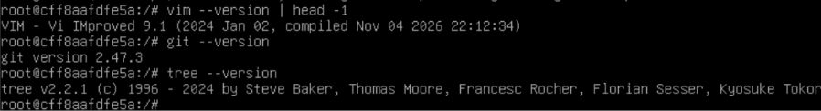

`htop` dans le conteneur :

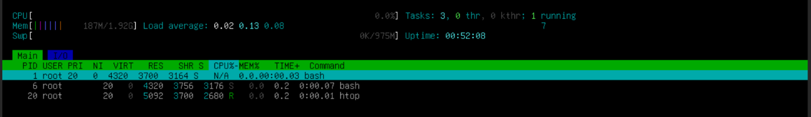

`mc` dans le conteneur :mc dans le conteneur

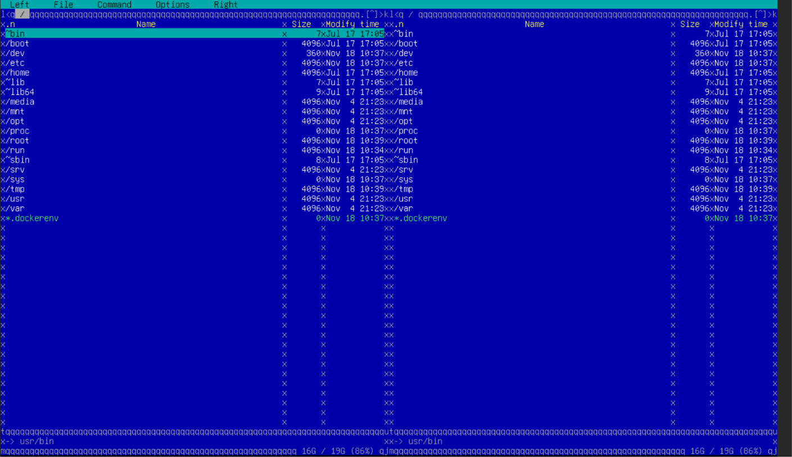

### Image plus légère : Alpine

Pour obtenir une image plus légère, nous utilisons Alpine Linux à la place de Debian. Les outils s’installent avec `apk`, le gestionnaire de paquets d’Alpine.

```docker
FROM alpine:latest
RUN apk add --no-cache vim git htop mc tree
```

Nous construisons cette seconde image, lançons un conteneur et entrons dedans avec `sh`, car Alpine n’a pas `bash` par défaut.

```bash
docker build -t btssio:alpine -f Dockerfile.alpine .
docker run -tid --name sisr2 btssio:alpine
docker exec -ti sisr2 sh
```

### Comparaison des tailles

Nous comparons la taille des deux images avec `docker images`.

| Image | Taille |
| --- | --- |
| `debian:stable-slim` (base) | 78,9 Mo |
| `btssio:v1.0` (Debian + outils) | **266 Mo** |
| `alpine:latest` (base) | 8,43 Mo |
| `btssio:alpine` (Alpine + outils) | **66 Mo** |

L’image Alpine est environ **4 fois plus légère** (66 Mo contre 266 Mo) pour les mêmes fonctionnalités.

Comparaison des tailles :

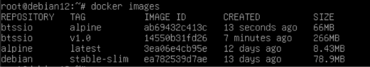

Nous vérifions que les outils fonctionnent aussi dans le conteneur Alpine (shell `sh`, pas `bash`) :

Test du conteneur Alpine :

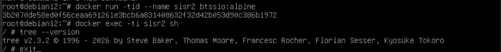

Nous nettoyons ensuite les conteneurs et les images avant la partie suivante :

```bash
docker rm -f $(docker ps -aq)
docker rmi btssio:v1.0 btssio:alpine
```

---

## 4. Orchestration avec Docker Compose

### Préparation

Pour cette dernière partie, nous déployons une application Flask qui utilise une base Redis pour compter les visites. Nous créons d’abord un dossier `projet`.

```bash
mkdir projet && cd projet
```

Nous y créons trois fichiers : `requirements.txt` (Flask, Redis), `app.py` (application Flask avec compteur Redis) et `Dockerfile`. Le Dockerfile installe les dépendances Python et lance l’application.

```docker
FROM python:2.7-slim
WORKDIR /app
COPY . /app
RUN pip install -r requirements.txt
EXPOSE 80
ENV NOM BTS SIO2 SISR
CMD ["python", "app.py"]
```

### Image personnalisée et test seul

Nous construisons notre image `monimage`, puis la lançons seule pour tester l’application avant d’ajouter Redis. Le conteneur de test est supprimé juste après.

```bash
docker build -t monimage .
docker run -d -p 80:80 --name test monimage
curl localhost
docker rm -f test
```

Sans Redis, la page s’affiche mais le compteur de visites est désactivé.

### docker-compose.yml

Pour relier l’application à Redis, nous créons un fichier `docker-compose.yml`. Il décrit les deux conteneurs (`monapp` et `redis`) et le réseau commun `monreseau` qui leur permet de communiquer.

```yaml
version:"3"
services:
monapp:
image: monimage
depends_on:
- redis
ports:
-"80:80"
networks:
- monreseau
environment:
- NOM=les SISR
redis:
image: redis
networks:
- monreseau
networks:
monreseau:
```

Nous lançons ensuite l’ensemble avec `docker-compose up`.

```bash
docker-compose up
```

Résultat dans le navigateur : la page s’affiche avec le compteur, qui s’incrémente à chaque actualisation.

Application avec compteur de visites

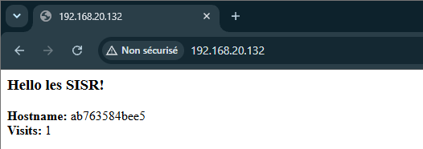

192.168.20.132 → @IP de ma machine

Nous arrêtons et supprimons les conteneurs avec :

```bash
docker-compose down
```

### Hostname = SaintLuc

Le hostname affiché par l’application est celui du conteneur. Pour le changer en `SaintLuc`, nous ajoutons la ligne `hostname: SaintLuc` dans le service `monapp` :

```yaml
monapp:
image: monimage
hostname: SaintLuc
depends_on:
- redis
    ...
```

Nous relançons ensuite les conteneurs pour appliquer la modification :

```bash
docker-compose down
docker-compose up
```

La modification est appliquée : le hostname affiché est bien **SaintLuc**.

Hostname SaintLuc

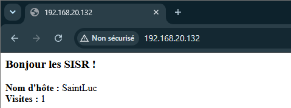

### Nettoyage final

Pour terminer, nous supprimons tous les conteneurs et les images créés pendant le TP :

```bash
docker-compose down
docker rm -f $(docker ps -aq)
docker rmi monimage redis
```

---

